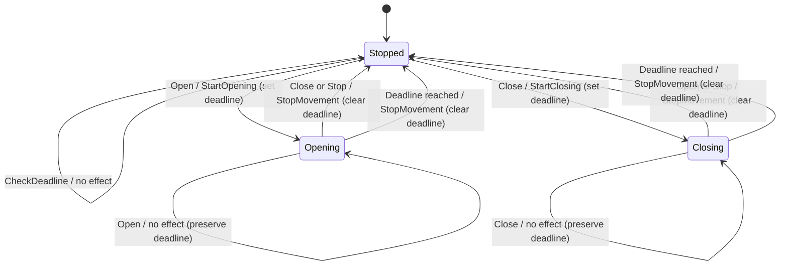

# Covers Controller

## Overview

Motorized window shades controlled via relays on Unipi Neuron, with both physical push buttons and Home Assistant integration.

## Status

Nest implements a standalone movement FSM in `internal/controller/cover`.
Cover configuration, entity translation, and registry lookups are implemented.
Runtime integration and position tracking remain unimplemented.
The Nest diagram below describes current movement decisions, not confirmed hardware state.
The later legacy sections describe the earlier cover service and design ideas, not implemented Nest behavior.
See [Implementation Plan](implementation-plan.md#phase-9-local-cover-controller) for the proposed migration scope.

## Nest Movement FSM



- Labels show input or condition, followed by effect and deadline change
- State describes movement intent, not output confirmation or estimated position
- The initial Stopped state does not confirm that hardware outputs are off
- At or past the deadline, stopping takes precedence over every input
- Before the deadline, `CheckDeadline` has no effect in either moving state
- An opposite-direction request stops movement without queuing a reversal
- A subsequent direction request can start another movement
- Runtime integration owns timers and submits `CheckDeadline` with the current time
- Deadline checks use the current state, so stale notifications cannot stop a newer movement early
- Effects perform no I/O; runtime integration must enforce relay interlocks and handle output failures

## Nest Configuration

Set one global maximum run duration for all covers:

```yaml
cover_control:
  max_run: 30s
```

Omitting `max_run` or setting it to zero selects the 30-second default.
Negative values are rejected.
This duration bounds relay activation, independently of position calibration.
Per-cover overrides are not supported.

Declare covers under each unit's `entities`:

```yaml
covers:
  - id: office
    name: Office
    open_actuator: { actor: sysfs, kind: relay, id: office_up }
    close_actuator: { actor: sysfs, kind: relay, id: office_down }
```

Actuator references resolve to relays under the same unit's `actors.sysfs.relays`.
Each cover requires two distinct, exclusively owned physical relays.
Neither relay can serve another cover or a light, including through a differently named alias.
The semantic cover ID is `<unit>.cover.office`.
The cover entity contains identity and typed relay references, not live movement state or a per-cover duration.
The registry exposes shared cover settings, cover lookup by ID, and owner lookup by relay ID.
Button bindings and MQTT cover commands remain deferred.
See [the cover fixture](../test/fixtures/config.covers.yaml) for a complete example with two units and a separate light.
Loading this configuration does not start cover control.

## Hardware

### Wiring

- **Up relay**: Opens shade (connected to motor's "up" wire)
- **Down relay**: Closes shade (connected to motor's "down" wire)
- **Push buttons**: Wall-mounted toggle buttons connected to Unipi DI

### Relay Logic

Motorized shades typically use two relays:

- **Relay ON (1)**: Activates the relay, motor runs
- **Relay OFF (0)**: Deactivates the relay, motor stops

**Important:** Both relays should never be ON simultaneously (short circuit protection).

## Legacy State Machine

```
        ┌──────────────┐
        │   STOPPED    │
        │  (idle)      │
        └──────┬───────┘
               │
     ┌─────────┴─────────┐
     │                   │
     ▼                   ▼
┌─────────────┐   ┌─────────────┐
│  OPENING    │   │  CLOSING    │
│ (motor up)  │   │ (motor down)│
└─────────────┘   └─────────────┘
     │                   │
     │           ┌───────┘
     ▼           ▼
┌─────────────┐
│    OPEN     │
│ (position=100)│
└─────────────┘

┌─────────────┐
│   CLOSED   │
│ (position=0)│
└─────────────┘
```

### State Definitions

| State     | Motor           | Position | Description              |
| --------- | --------------- | -------- | ------------------------ |
| `OPEN`    | Both OFF        | 100      | Shade fully open         |
| `CLOSED`  | Both OFF        | 0        | Shade fully closed       |
| `OPENING` | Up ON, Down OFF | 0→100    | Motor running up         |
| `CLOSING` | Up OFF, Down ON | 100→0    | Motor running down       |
| `STOPPED` | Both OFF        | 0-100    | Motor stopped mid-travel |

### Transitions

| From                    | Command       | To      |
| ----------------------- | ------------- | ------- |
| STOPPED/OPENING/CLOSING | `OPEN`        | OPENING |
| STOPPED/OPENING/CLOSING | `CLOSE`       | CLOSING |
| OPENING/CLOSING         | `STOP`        | STOPPED |
| OPENING                 | (reaches 100) | OPEN    |
| CLOSING                 | (reaches 0)   | CLOSED  |

## Position Tracking

Position is tracked as percentage (0-100):

- `0` = fully closed
- `100` = fully open

**Tracking Method:** Time-based estimation

- Configure `max_time` (seconds to go from 0→100)
- Increment position every `sleep_time` based on direction

**Edge Cases:**

- Position stops at boundaries (0 and 100)
- Motor automatically stops at limits (if properly wired)
- If stopped mid-travel, position is preserved

## MQTT Interface

### Topics

```
covers/{name}/command     # Incoming commands (OPEN/CLOSE/STOP)
covers/{name}/state       # Current state (OPEN/OPENING/STOPPED/CLOSING/CLOSED)
covers/{name}/position    # Position as integer 0-100
shady/{relay}/command      # Relay commands (ON/OFF)
shady/{relay}/state       # Relay state (ON/OFF)
```

### Messages

**Commands (incoming):**

- `OPEN` - Start opening
- `CLOSE` - Start closing
- `STOP` - Stop motor

**States (outgoing):**

- `open`
- `closed`
- `opening`
- `closing`
- `stopped`

**Position:** Integer `0` to `100`

## Home Assistant Integration

### MQTT Cover Configuration

```yaml
cover:
  - platform: mqtt
    name: "office"
    command_topic: "covers/office/command"
    state_topic: "covers/office/state"
    position_topic: "covers/office/position"
    set_position_topic: "covers/office/position/set"
    device_class: shade
    optimistic: true
```

### Push Button Automation

```yaml
automation:
  - alias: Office toggle open start
    trigger:
      platform: state
      entity_id: switch.office_open
      from: "off"
      to: "on"
    action:
      service: cover.open_cover
      entity_id: cover.office

  - alias: Office toggle open stop
    trigger:
      platform: state
      entity_id: switch.office_open
      from: "on"
      to: "off"
    action:
      service: cover.stop_cover
      entity_id: cover.office
```

## Current Implementation (covers/)

**Language:** Python (asyncio)\
**Architecture:** MQTT → covers.py → MQTT (relay commands)

**Limitations:**

- Depends on evok2mqtt for relay control
- Requires MQTT broker
- Position tracking via MQTT relay states

## Planned Implementation (nest)

**Language:** Go\
**Architecture:** Direct sysfs → nest → MQTT

**Advantages:**

- Direct relay control (no evok2mqtt dependency)
- Standalone from Home Assistant
- Single binary deployment
- HA still receives state updates via MQTT

**Todo:**

- [x] MQTT client and Home Assistant light integration; cover integration remains pending
- [ ] Cover entity with state machine
- [ ] Position tracking
- [ ] Push button input handling
- [ ] Relay output control
- [ ] Configuration via YAML

## Configuration Schema

```yaml
covers:
  office:
    up_relay: "ro-3-14"
    down_relay: "ro-3-13"
    max_time: 30 # seconds
  bedroom:
    up_relay: "ro-3-11"
    down_relay: "ro-3-12"
    max_time: 25

mqtt:
  host: "localhost"
  port: 1883
  base_topic: "covers"

sysfs:
  path: "/run/unipi"
```
