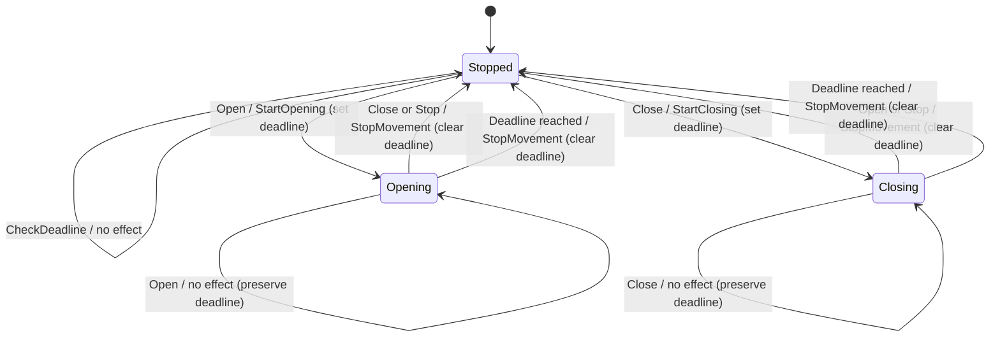

# Covers Controller

## Overview

Motorized window shades controlled via relays on Unipi Neuron, with both physical push buttons and Home Assistant integration.

## Status

Nest implements a standalone movement FSM in `internal/controller/cover`.
Cover configuration, entity translation, and registry lookups are implemented.
Nest implements sysfs cover execution, local button bindings, and time-based position estimates.
Nest accepts MQTT Open, Close, and Stop commands and publishes movement and estimated position.
The Nest diagram below describes current movement decisions, not confirmed hardware state.
See [Legacy Cover Controller](../reference/legacy-covers.md) for the earlier service and historical design sketches.
See [Implementation Plan](../planning/implementation-plan.md#phase-9-local-cover-controller) for the rollout record.

## Nest Movement FSM



- Labels show input or condition, followed by effect and deadline change
- State describes movement intent, not output confirmation or estimated position
- The initial Stopped state does not confirm that hardware outputs are off
- At or past the deadline, stopping takes precedence over every input
- Before the deadline, `CheckDeadline` has no effect in either moving state
- An opposite-direction request stops movement without queuing a reversal
- A subsequent direction request can start another movement
- The sysfs runtime owner owns timers and submits `CheckDeadline` with the current time
- Deadline checks use the current state, so stale notifications cannot stop a newer movement early
- Effects perform no I/O; runtime integration must enforce relay interlocks and handle output failures

## Runtime Ownership

The sysfs actor owns each local cover's FSM state, deadline timer, relay execution, and cleanup.
The controller routes semantic cover requests and normalizes cover observations.
The controller maps local button events to cover requests.
The commands channel carries cover requests; the states channel carries cover state and failures.
Neither channel requires an acknowledgement for each relay write.
Cover observations identify the cover rather than repeat hardware addresses or output-pair commands.

This deliberately makes sysfs cover-aware to avoid cross-layer movement coordination.
The pure FSM remains unchanged and independent of I/O.
Its current location under `internal/controller/cover` does not assign runtime ownership to the controller.
See [Local Cover Execution Ownership](design.md#local-cover-execution-ownership) for responsibilities and safety constraints.
Cover-owned outputs are excluded from ordinary polling workers and reject direct single-device commands.
One actor-local timer schedules the earliest movement deadline.
Cover snapshots coalesce when consumers are slow; they do not guarantee delivery of every intermediate transition.
Output failures stop the actor and runtime after cleanup attempts.
Failure snapshots include the previous movement state and an error, not a claim that the outputs stopped.
Runtime errors preserve failures even if the states channel cannot accept a failure snapshot.
Shutdown attempts to turn both outputs off for every cover without waiting for observation delivery.
Cleanup failures are logged and returned; they cannot guarantee that the hardware stopped.
Existing light control remains in the controller and continues to use single-device sysfs commands.

## Nest Position Estimates

- Start at unknown after each restart
- Keep position unknown after a stop before the first movement deadline
- Estimate 100% after an opening deadline and 0% after a closing deadline
- Apply the endpoint only after both relays turn off successfully
- Estimate later positions from elapsed movement time and the last known estimate
- Freeze the estimate when either direction stops
- Report known estimates in movement snapshots and once per second during movement
- Keep the movement deadline active regardless of the position estimate

The estimate assumes a full travel fits within the configured maximum run duration.
Verify that assumption on hardware before relying on the estimate.

## Nest Configuration

Set one global maximum run duration for all covers:

```yaml
cover_control:
  max_run: 30s
```

Omitting `max_run` or setting it to zero selects the 30-second default.
Negative values are rejected.
This duration bounds relay activation and supplies the full-travel time for position estimates.
Per-cover overrides are not supported.

Declare covers under each unit's `entities`:

```yaml
covers:
  - id: office
    name: Office
    open_actuator: { actor: sysfs, kind: relay, id: office_up }
    close_actuator: { actor: sysfs, kind: relay, id: office_down }
```

Actuator references resolve to relays under the same unit's `actors.sysfs.relays`.
Each cover requires two distinct, exclusively owned physical relays.
Neither relay can serve another cover or a light, including through a differently named alias.
The semantic cover ID is `<unit>.cover.office`.
The cover entity contains identity and typed relay references, not live movement state or a per-cover duration.
The registry exposes shared cover settings, cover lookup by ID, and owner lookup by relay ID.
MQTT cover commands remain deferred.
See [the cover fixture](../../test/fixtures/config.covers.yaml) for a complete example with two units and a separate light.
Starting the runtime initializes configured covers with both outputs off and enables their local execution owner.
Loading or validating configuration alone does not start cover control.
